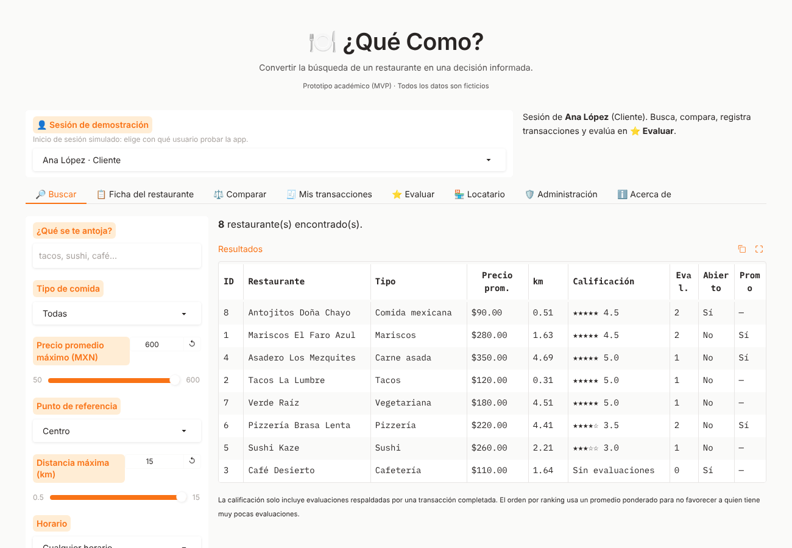
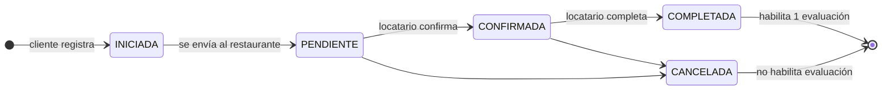
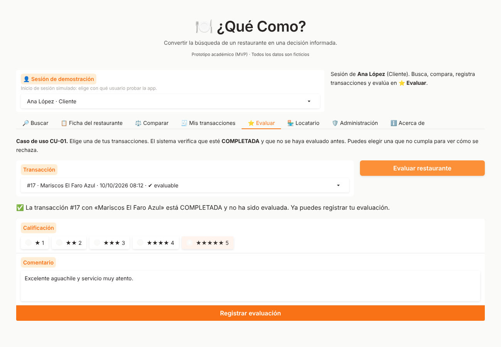
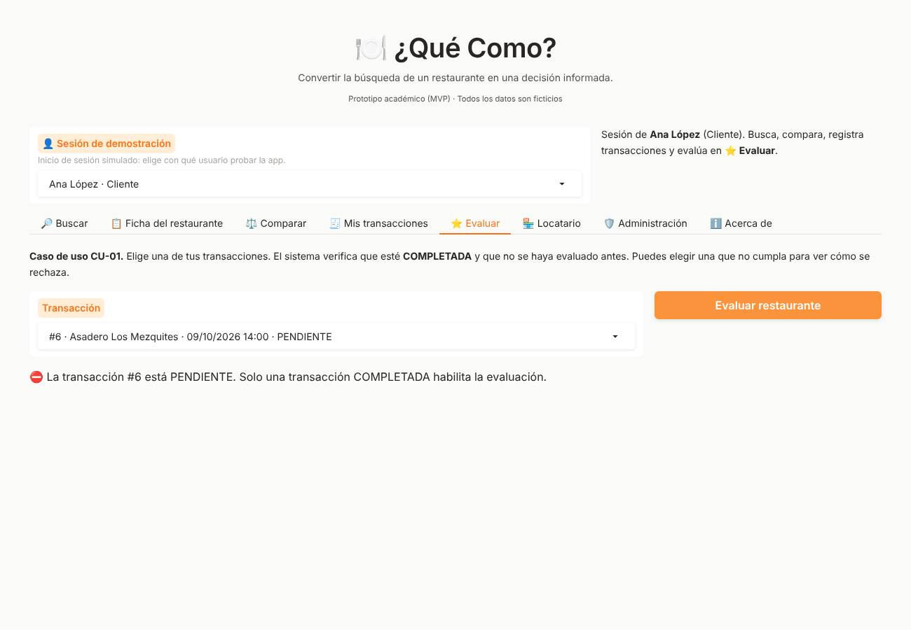
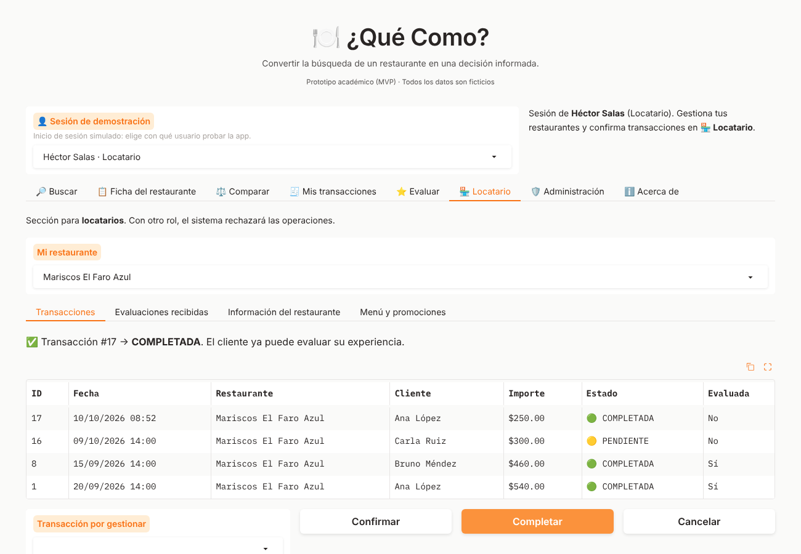
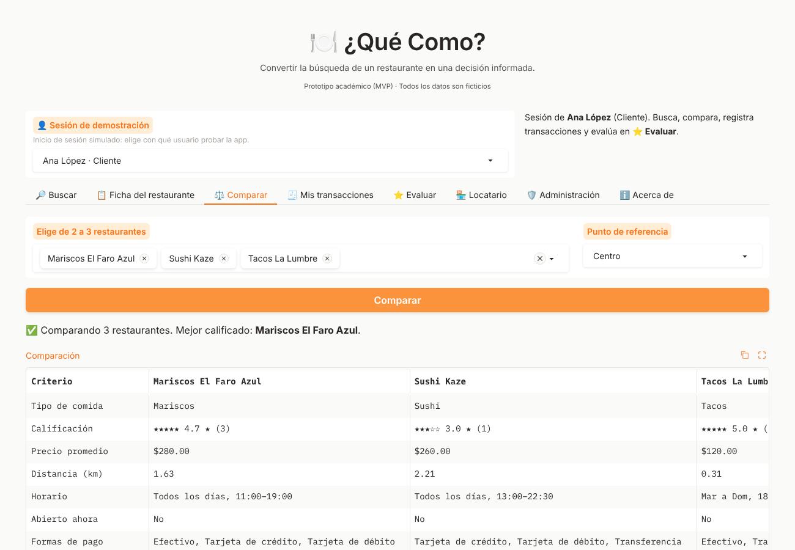
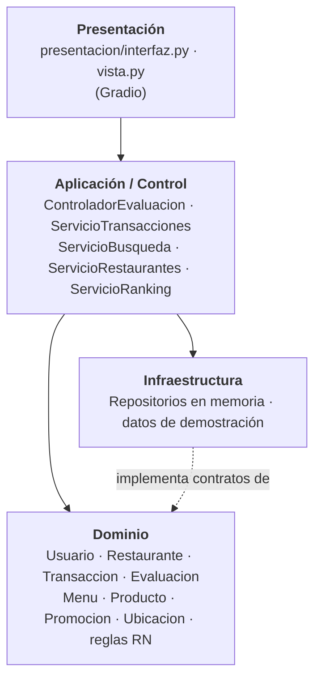

# 🍽️ ¿Qué Como?

> *Convertir la búsqueda de un restaurante en una decisión informada.*

**¿Qué Como?** es una plataforma web para **descubrir, filtrar, comparar y evaluar restaurantes**. Su diferenciador es la **trazabilidad de las evaluaciones**: solo puede evaluar quien tiene una **transacción completada** con el restaurante, y cada transacción respalda **una sola** evaluación.

Este repositorio contiene el **MVP académico** desarrollado en Python con [Gradio](https://www.gradio.app/), construido a partir del *Documento Fundamental de Desarrollo* (Actividades 1–4 de Ingeniería de Software), incluido en [`docs/referencias/`](docs/referencias/).


> ℹ️ Sustituye `OWNER/REPO` en la insignia de pruebas por tu usuario y nombre de repositorio de GitHub.



---

## Contenido

- [Funcionalidades](#funcionalidades)
- [La regla de confianza](#la-regla-de-confianza)
- [Inicio rápido](#inicio-rápido)
- [Cómo probarla en 2 minutos](#cómo-probarla-en-2-minutos)
- [Arquitectura](#arquitectura)
- [Estructura del repositorio](#estructura-del-repositorio)
- [Pruebas](#pruebas)
- [Documentación](#documentación)
- [Limitaciones y riesgos conocidos](#limitaciones-y-riesgos-conocidos)
- [Hoja de ruta](#hoja-de-ruta)
- [Créditos y licencia](#créditos-y-licencia)

---

## Funcionalidades

| Pestaña | Qué permite | Historias |
|---|---|---|
| 🔎 **Buscar** | Buscar por texto (incluye platillos del menú) y filtrar por tipo de comida, precio, distancia, horario, forma de pago en el local, calificación mínima y promociones. Ordenar por ranking, cercanía, precio o antigüedad. | HU-01, HU-02, HU-05 |
| 📋 **Ficha del restaurante** | Descripción, horario, ubicación, formas de pago en el local, antigüedad, menú, promociones vigentes, distribución de calificaciones y evaluaciones verificadas. | HU-03, HU-05 |
| ⚖️ **Comparar** | Comparar de 2 a 3 restaurantes lado a lado en 11 criterios. | HU-04 |
| 🧾 **Mis transacciones** | Registrar un consumo y seguir su estado; cancelar si aún no concluye. | HU-06 |
| ⭐ **Evaluar** | Caso de uso **CU-01**: validar la transacción y registrar la evaluación. Muestra el motivo exacto cuando se rechaza. | HU-07, HU-08 |
| 🏪 **Locatario** | Confirmar/completar transacciones, consultar evaluaciones recibidas, registrar y editar el restaurante, agregar productos y promociones. | HU-09, HU-10, HU-11 |
| 🛡️ **Administración** | Suspender/activar restaurantes y moderar evaluaciones (con motivo obligatorio). | Rol Administrador |

## La regla de confianza



- **RN-01** Solo evalúa quien tiene una transacción válida con el restaurante.
- **RN-03** Toda evaluación queda vinculada a usuario, restaurante y transacción.
- **RN-04** Una evaluación nunca crea ni justifica una transacción.
- **RN-05** Una transacción cancelada o incompleta no habilita la evaluación.
- **RN-06** Una transacción respalda como máximo una evaluación.
- **RN-07** ¿Qué Como? **no ofrece ni procesa pagos en línea**: solo informa si el restaurante acepta efectivo o tarjeta en el local.
- **CA-08** El cliente **no** puede completar su propia transacción; el administrador **tampoco** puede fabricar esa evidencia. Solo el locatario dueño la confirma y completa.

La decisión `puede_evaluarse()` vive en la clase `Transaccion` (patrón GRASP *Information Expert*) y se aplica en `[estado == COMPLETADA AND noExisteEvaluacion]`.

## Inicio rápido

Requisitos: **Python 3.10 o superior** y Git.

```bash
# 1. Clonar el repositorio
git clone https://github.com/OWNER/REPO.git
cd REPO

# 2. Crear y activar un entorno virtual
python -m venv .venv
source .venv/bin/activate        # Windows: .venv\Scripts\activate

# 3. Instalar dependencias
pip install -r requirements.txt

# 4. Ejecutar
python app.py
```

Abre **http://127.0.0.1:7860** en el navegador.

Variables de entorno opcionales:

| Variable | Uso | Valor por defecto |
|---|---|---|
| `QUECOMO_ZONA_HORARIA` | Zona horaria para «abierto ahora» | `America/Hermosillo` |
| `GRADIO_SERVER_NAME` | Dirección de escucha (`0.0.0.0` para exponer en red) | `127.0.0.1` |
| `GRADIO_SERVER_PORT` | Puerto | `7860` |
| `PORT` | Puerto asignado por la nube (Render); activa `0.0.0.0` automáticamente | — |

## Cómo probarla en 2 minutos

La app incluye **datos ficticios** y un **inicio de sesión simulado** (selector «👤 Sesión de demostración»).

1. Como **Ana López (Cliente)**, abre **⭐ Evaluar**: la transacción con *Tacos La Lumbre* ya es evaluable. Pulsa **Evaluar restaurante**, califica y comenta.
2. Elige ahora una transacción **PENDIENTE**, **CANCELADA** o **ya evaluada**: el sistema la rechaza explicando por qué.
3. En **🧾 Mis transacciones**, registra un consumo nuevo en *Mariscos El Faro Azul*.
4. Cambia la sesión a **Héctor Salas (Locatario)**, ve a **🏪 Locatario**, selecciona la transacción, pulsa **Confirmar** y luego **Completar**.
5. Vuelve a **Ana López**: la nueva transacción aparece como «✔ evaluable».

| Usuario de demostración | Rol | Para probar |
|---|---|---|
| Ana López, Bruno Méndez, Carla Ruiz | Cliente | Buscar, transacciones, evaluar |
| Héctor Salas, Elena Torres, Fernando Ibarra | Locatario | Gestionar restaurantes y transacciones |
| Gabriela Núñez | Administrador | Moderación |

### Capturas

| Evaluación (CU-01) | Rechazo con motivo |
|---|---|
|  |  |
| **Panel del locatario** | **Comparación** |
|  |  |

## Arquitectura

Arquitectura en **cuatro capas** (sección 9 del Documento Fundamental). Las dependencias apuntan hacia el dominio; el dominio no conoce Gradio ni la persistencia.



Más detalle en [`docs/06_arquitectura.md`](docs/06_arquitectura.md).

## Estructura del repositorio

```
que-como/
├── app.py                         # Punto de entrada: python app.py
├── src/quecomo/
│   ├── dominio/                   # Entidades, estados, excepciones, contratos de repositorio
│   ├── aplicacion/                # Controlador CU-01 y servicios de casos de uso
│   ├── infraestructura/           # Repositorios en memoria y datos de demostración
│   ├── presentacion/              # Interfaz Gradio (interfaz.py) y adaptador (vista.py)
│   └── configuracion.py           # Raíz de composición: arma la aplicación
├── tests/                         # 114 pruebas (unitarias, integración y presentación)
├── docs/                          # Documentación de ingeniería, legal y de negocio
│   └── referencias/               # Documento Fundamental original (PDF)
├── .github/workflows/pruebas.yml  # Integración continua
├── render.yaml · .python-version  # Despliegue en Render
├── requirements.txt / requirements-dev.txt / pyproject.toml
└── CONTRIBUTING.md · CHANGELOG.md · LICENSE
```

## Pruebas

```bash
pip install -r requirements-dev.txt
pytest                                     # ejecutar todas
pytest --cov=quecomo --cov-report=term     # con cobertura
ruff check .                               # estilo
```

Las pruebas están trazadas a los criterios de aceptación (CA-01…CA-08) y reglas de negocio (RN-01…RN-06). Ver [`docs/09_pruebas.md`](docs/09_pruebas.md).

## Documentación

| Documento | Contenido |
|---|---|
| [01 · Visión y usuarios](docs/01_vision_y_usuarios.md) | Problema, propuesta, Vision Statement, actores, proto-personas, escenario |
| [02 · Historias y backlog](docs/02_historias_y_backlog.md) | HU-01…HU-12 con estado de implementación |
| [03 · Requisitos y reglas](docs/03_requisitos_y_reglas.md) | RF, RN, requisitos de calidad y dónde se implementan |
| [04 · Caso de uso CU-01](docs/04_caso_de_uso_CU01.md) | Flujo principal, extensiones y su realización en código |
| [05 · Modelo de dominio](docs/05_modelo_de_dominio.md) | Conceptos, asociaciones y diagrama de clases |
| [06 · Arquitectura](docs/06_arquitectura.md) | Capas, GRASP, decisiones de diseño |
| [07 · Diseño dinámico](docs/07_diseno_dinamico.md) | Diagrama de secuencia y máquina de estados |
| [08 · Trazabilidad](docs/08_trazabilidad.md) | Matriz problema → HU → RN → código → pruebas |
| [09 · Pruebas](docs/09_pruebas.md) | Estrategia y mapeo CA/RN → pruebas |
| [10 · Cumplimiento legal (preliminar)](docs/10_cumplimiento_legal.md) | Datos personales, licencias, riesgos (México) |
| [11 · Validación y modelo de negocio](docs/11_validacion_y_modelo_de_negocio.md) | Hipótesis, experimentos, métricas, riesgos |
| [12 · GitHub y despliegue](docs/12_guia_github_y_despliegue.md) | Subir el repositorio y publicar la demo (Render o Hugging Face) |

## Limitaciones y riesgos conocidos

- **Inicio de sesión simulado.** No hay contraseñas ni autenticación real; el selector de usuario existe solo para la demostración.
- **Datos en memoria.** Se reinician al reiniciar la app. Los contratos de repositorio permiten cambiar a SQLite/PostgreSQL sin tocar el dominio.
- **Sin pagos en línea (decisión de producto).** La app no cobra ni ofrece transferencias o pasarelas: el pago ocurre en el restaurante y la transacción es solo el registro del consumo, que el restaurante confirma y completa manualmente.
- **Riesgo de diseño importante:** como el locatario decide si una transacción se completa, podría **no completar** las de clientes insatisfechos para evitar malas evaluaciones. Ver mitigaciones propuestas en [`docs/11_validacion_y_modelo_de_negocio.md`](docs/11_validacion_y_modelo_de_negocio.md#4-riesgo-crítico-el-locatario-controla-la-evidencia).
- **Uso no apto para producción** sin antes atender los pendientes de [`docs/10_cumplimiento_legal.md`](docs/10_cumplimiento_legal.md) (aviso de privacidad, términos de uso, autenticación, persistencia segura).

## Hoja de ruta

1. Persistencia con SQLite y migraciones.
2. Autenticación real y gestión de sesiones.
3. Mitigación del sesgo del locatario (confirmación automática con plazo, código de ticket, disputas).
4. Casos de uso restantes como documentos formales (búsqueda, comparación, registro de restaurante).
5. HU-12: evaluación del restaurante hacia el cliente (si la regla de negocio lo habilita).
6. Aviso de privacidad y términos de uso revisados profesionalmente.
7. Despliegue público (Hugging Face Spaces) y prueba con usuarios reales.

## Créditos y licencia

Proyecto académico de la materia de **Ingeniería de Software**.
Autores: **[Nombre(s) del equipo]** — *edita esta línea antes de publicar*.

Código bajo licencia **MIT** (ver [`LICENSE`](LICENSE)). Verifica que tu institución no establezca condiciones distintas sobre la titularidad de los trabajos académicos antes de publicar.

Todos los restaurantes, personas y evaluaciones de los datos de demostración son **ficticios**.
