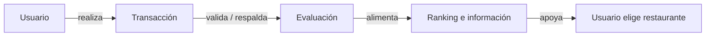

# 01 · Visión, usuarios y escenario

> Fuente: Documento Fundamental, secciones 1 y 2 (Actividad 1).

## 1. Problema

Quien quiere elegir dónde comer encuentra la información **dispersa** entre mapas, redes sociales, menús y reseñas. Necesita combinar varios criterios a la vez: **precio, calidad, distancia, ubicación, horarios, formas de pago, menú, promociones, antigüedad y evaluaciones**.

El problema no es solo encontrar restaurantes, sino **comparar alternativas con información suficiente** y **confiar** en las evaluaciones.

## 2. Propuesta de solución

Una plataforma digital de **conexión, consulta, comparación y evaluación** entre usuarios y restaurantes, cuyas evaluaciones están **vinculadas a transacciones**.

**Diferenciador:** una evaluación no se considera evidencia válida si el sistema no puede identificar una transacción real y válida entre el usuario y el restaurante.

## 3. Vision Statement

> **PARA** usuarios que necesitan encontrar y seleccionar un restaurante de acuerdo con sus necesidades y preferencias, **QUIENES** buscan comparar alternativas considerando precio, calidad, distancia, horarios, ubicación, menú, promociones, formas de pago, antigüedad y ranking, **¿QUÉ COMO? ES** una plataforma digital de conexión, consulta, comparación y evaluación entre usuarios y restaurantes, **QUE** permite descubrir, consultar y comparar establecimientos para facilitar decisiones gastronómicas, **A DIFERENCIA DE** utilizar múltiples fuentes dispersas o depender de evaluaciones sin trazabilidad, **NUESTRO PRODUCTO** integra criterios relevantes y establece un sistema de evaluación basado en transacciones reales entre usuarios y restaurantes.

## 4. Actores del ecosistema

| Actor | Necesidad principal | Interacción con ¿Qué Como? | En el MVP |
|---|---|---|---|
| **Cliente / Usuario** | Encontrar y comparar restaurantes | Busca, filtra, consulta, compara, registra consumos y evalúa | Pestañas Buscar, Ficha, Comparar y Evaluar (incluye «Registrar un consumo nuevo») |
| **Locatario / Restaurante** | Presentar información confiable y recibir retroalimentación real | Administra información, menú, horarios, pagos, promociones; consulta evaluaciones | Pestaña Locatario |
| **Administrador** | Mantener la integridad de la plataforma | Moderación y control de restaurantes | Pestaña Administración |

## 5. Proto-personas

| Proto-persona | Objetivo | Necesidades / frustraciones | Valor esperado |
|---|---|---|---|
| Usuario / Cliente | Elegir un restaurante adecuado | No quiere revisar muchas fuentes; necesita comparar rápido y confiar | Información integrada y comparación clara |
| Locatario | Atraer clientes y administrar su presencia | Información actualizada y retroalimentación confiable | Perfil administrable y evaluaciones vinculadas a transacciones |

> ⚠️ Las proto-personas son **supuestos** del equipo, no resultados de investigación con usuarios. Ver [11 · Validación](11_validacion_y_modelo_de_negocio.md) para el plan de validación.

## 6. Escenario narrativo crítico

Un usuario abre ¿Qué Como? porque quiere comer fuera con restricciones de presupuesto, distancia y horario. Selecciona tipo de comida, rango de precio, distancia máxima y horario. El sistema presenta restaurantes compatibles. El usuario consulta varios perfiles y compara menú, precios, ubicación, formas de pago, promociones, horario y ranking. Elige un restaurante y consume. La transacción queda registrada. Cuando la transacción se completa, ¿Qué Como? le permite evaluar y relaciona la evaluación con la transacción que demuestra la interacción comercial.

**Cómo se recorre en el MVP:** Buscar → Ficha → Comparar → Evaluar › Registrar un consumo nuevo → (Locatario › Confirmar consumos) → Evaluar.

## 7. Núcleo funcional

