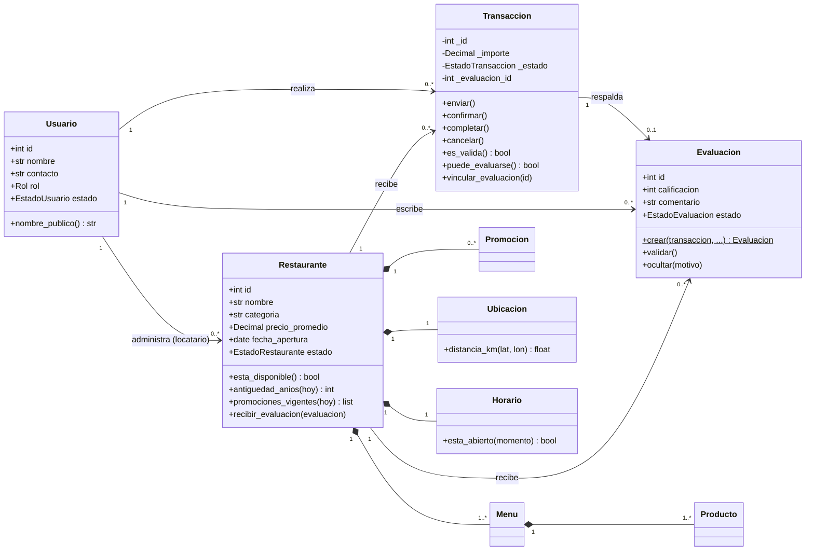

# 05 · Modelo de dominio

> Fuente: Documento Fundamental, sección 6. Código: `src/quecomo/dominio/entidades.py`.

## Conceptos

| Concepto | Atributos esenciales | Responsabilidad | Clase |
|---|---|---|---|
| Usuario | id, nombre, contacto, rol, estado | Participa en transacciones y evaluaciones | `Usuario` |
| Restaurante | id, nombre, descripción, categoría, horarios, formas de pago en el local (RN-07), precio promedio, fecha de apertura, estado | Información presentada al usuario | `Restaurante` |
| Transacción | id, fecha, importe, estado, historial | Demuestra la relación comercial y decide si respalda una evaluación | `Transaccion` |
| Evaluación | id, calificación, comentario, fecha, estado | Retroalimentación vinculada a una transacción | `Evaluacion` |
| Menú | id, nombre, descripción, activo | Agrupa la oferta | `Menu` |
| Producto | id, nombre, descripción, precio, disponible | Elemento del menú | `Producto` |
| Promoción | id, descripción, vigencia, condiciones | Oferta aplicable | `Promocion` |
| Ubicación | dirección, coordenadas, zona | Ubicación y cálculo de distancia | `Ubicacion` (objeto de valor) |
| Horario | días, apertura, cierre | Saber si está abierto (incluso cruzando medianoche) | `Horario` (objeto de valor, agregado en la implementación) |

## Diagrama de clases (diseño)

## Asociaciones y multiplicidades

| Relación | Multiplicidad | Cómo se representa en el código |
|---|---|---|
| Usuario — Transacción | 1 → 0..* | `Transaccion.usuario_id` |
| Restaurante — Transacción | 1 → 0..* | `Transaccion.restaurante_id` |
| **Transacción — Evaluación** | **1 → 0..1** | `Transaccion.evaluacion_id` + unicidad en el repositorio |
| Usuario — Evaluación | 1 → 0..* | `Evaluacion.usuario_id` (copiado de la transacción) |
| Restaurante — Evaluación | 1 → 0..* | `Evaluacion.restaurante_id` (copiado de la transacción) |
| Restaurante — Menú | 1 → 1..* | `Restaurante.menus` (se crea «Menú principal» si no existe) |
| Menú — Producto | 1 → 1..* | `Menu.productos` |
| Restaurante — Promoción | 1 → 0..* | `Restaurante.promociones` |
| Restaurante — Ubicación | 1 → 1 | `Restaurante.ubicacion` |
| Locatario — Restaurante | 1 → 0..* | `Restaurante.locatario_id` *(agregada en la implementación)* |

Las relaciones se guardan por **identificador** (no por referencia de objeto) para que el modelo pase fácilmente a una base de datos relacional en la siguiente etapa.

## Ajustes respecto al documento original

- Se agregó **`Horario`** como objeto de valor para responder «¿está abierto a esta hora?», incluido el caso de restaurantes que cierran después de medianoche.
- Se agregó el **rol** al `Usuario` y la relación **Locatario → Restaurante**, necesarios para la autorización.
- `Evaluacion` tiene **estado** (`PUBLICADA` / `OCULTA`) para la moderación.
- La operación `Evaluacion.registrar()` del documento se asignó al **repositorio** (`guardar`), para que la entidad no dependa de la persistencia (*Low Coupling*).
