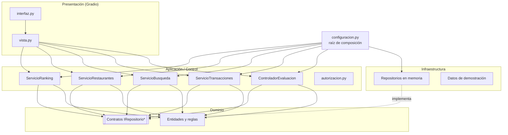

# 06 · Arquitectura y diseño

> Fuente: Documento Fundamental, secciones 7, 8 y 9.

## Capas

| Capa | Responsabilidad | Paquete |
|---|---|---|
| **Presentación** | Interfaz web (Gradio), identidad visual (`tema.py`) y redacción de mensajes. No contiene reglas del dominio. | `quecomo.presentacion` |
| **Aplicación / Control** | Controladores y servicios que coordinan cada caso de uso y aplican la autorización por rol. | `quecomo.aplicacion` |
| **Dominio** | Entidades, estados, reglas de negocio y contratos de repositorio. | `quecomo.dominio` |
| **Infraestructura** | Persistencia (en memoria en el MVP) y datos de demostración. | `quecomo.infraestructura` |



**Regla de dependencias:** el paquete `dominio` no importa nada de las otras capas. Se puede comprobar con:

```bash
grep -rnE --include="*.py" "^(import gradio|from \.\.(infraestructura|presentacion|aplicacion))" src/quecomo/dominio   # no debe devolver nada
```

## GRASP aplicado

| Principio | Aplicación | Justificación |
|---|---|---|
| **Information Expert** | `Transaccion.puede_evaluarse()` | La transacción conoce su estado y si ya fue evaluada |
| **Creator** | `ControladorEvaluacion` coordina `Evaluacion.crear(...)` | La creación ocurre dentro del caso de uso; la validación propia queda en `Evaluacion` |
| **Controller** | `ControladorEvaluacion` recibe la solicitud de CU-01 | Coordina sin concentrar la lógica del dominio |
| **Low Coupling** | Contratos de repositorio en el dominio; implementaciones en infraestructura | Cambiar la base de datos no toca las reglas |
| **High Cohesion** | Un servicio por grupo de casos de uso; `Vista` solo traduce | Evita una clase monolítica |
| **Pure Fabrication** | Repositorios, `ServicioRanking` | Responsabilidades técnicas que no pertenecen a ninguna entidad |
| **Protected Variations** | `IRepositorio*` y `reloj` inyectable | La persistencia y la hora pueden cambiar (o simularse en pruebas) sin afectar el resto |

## Clases de diseño (del documento al código)

| Documento | Código Python | Nota |
|---|---|---|
| `Transaccion.esValida()` | `Transaccion.es_valida()` | Convención *snake_case* de Python (PEP 8) |
| `Transaccion.puedeEvaluarse()` | `Transaccion.puede_evaluarse()` | |
| `Evaluacion.validar()` | `Evaluacion.validar()` | |
| `Evaluacion.registrar()` | `IRepositorioEvaluaciones.guardar()` | Ver ajuste en [05](05_modelo_de_dominio.md) |
| `ControladorEvaluacion.solicitarEvaluacion()` | `solicitar_evaluacion()` | Pasos 1–6 |
| `ControladorEvaluacion.validarTransaccion()` | Dentro de `solicitar_evaluacion()` | Delegada a la transacción |
| `ControladorEvaluacion.registrarEvaluacion()` | `registrar_evaluacion()` | Pasos 7–12 |
| `IRepositorioTransacciones.buscarPorUsuarioYEstablecimiento()` | `buscar_por_usuario_y_restaurante()` | Devuelve una **lista**: un usuario puede tener varias transacciones con el mismo restaurante |
| `IRepositorioEvaluaciones.obtenerPorEstablecimiento()` | `obtener_por_restaurante()` | |

## Visibilidad y encapsulamiento

- El controlador obtiene la `Transaccion` como **resultado de la búsqueda** del repositorio y la usa solo durante la operación (visibilidad local).
- `RepositorioEvaluaciones.guardar(evaluacion)` recibe la evaluación **por parámetro** (visibilidad de parámetro).
- Los atributos de `Transaccion` son privados (`_estado`, `_evaluacion_id`); se exponen como **propiedades de solo lectura**. Intentar `t.estado = ...` lanza `AttributeError` (probado en `test_el_estado_no_se_asigna_directamente`).

## Decisiones de diseño (ADR resumidas)

| # | Decisión | Alternativas | Motivo |
|---|---|---|---|
| ADR-01 | **Gradio** para la interfaz | Flask + HTML, Streamlit | Requisito del proyecto; prototipado rápido 100 % en Python |
| ADR-02 | Repositorios **en memoria** en el MVP | SQLite desde el inicio | Enfocar el esfuerzo en reglas y pruebas; los contratos dejan lista la migración |
| ADR-03 | **Reloj inyectable** (`reloj: Callable[[], datetime]`) | `datetime.now()` directo | Pruebas deterministas («abierto ahora», vigencia de promociones) |
| ADR-04 | **Doble validación** (controlador + repositorio) contra evaluaciones duplicadas | Solo en el controlador | Defensa en profundidad, como una restricción `UNIQUE` en base de datos |
| ADR-05 | **Promedio ponderado** para ordenar por ranking | Promedio simple | Evitar que 1 evaluación de 5★ supere a muchas de 4.8★. El promedio mostrado sigue siendo el simple |
| ADR-06 | `Vista` separada de `interfaz.py` | Lógica dentro de los *callbacks* | Probar la presentación sin servidor web |
| ADR-07 | Solo el locatario dueño confirma/completa transacciones | Cliente o administrador | Requisito de Seguridad y CA-08; ver riesgo asociado en [11](11_validacion_y_modelo_de_negocio.md) |
| ADR-08 | Identidad visual en `presentacion/tema.py` (paleta naranja–azul, Manrope, modo oscuro) | Tema predeterminado de Gradio | Separar estilo de estructura; un solo lugar para ajustar colores |
| ADR-09 | La interfaz dice «consumo»; el dominio, «transacción». `Vista` redacta los rechazos a partir de `MotivoRechazo` | Mostrar los mensajes del dominio tal cual | Lenguaje claro para usuarios sin cambiar el modelo ni la documentación técnica |
| ADR-10 | Sin pestaña de transacciones: el registro de consumo vive en «Evaluar» | Pestaña propia | Interfaz más simple; el consumo solo existe para poder evaluar |

## Siguiente paso de arquitectura: persistencia

Para pasar a SQLite basta con crear `infraestructura/sqlite.py` con clases que implementen los cuatro contratos y cambiarlas en `configuracion.crear_aplicacion()`. Esquema sugerido:

```sql
CREATE TABLE transacciones (
    id INTEGER PRIMARY KEY,
    usuario_id INTEGER NOT NULL REFERENCES usuarios(id),
    restaurante_id INTEGER NOT NULL REFERENCES restaurantes(id),
    importe NUMERIC NOT NULL CHECK (importe > 0),
    fecha TIMESTAMP NOT NULL,
    estado TEXT NOT NULL CHECK (estado IN ('INICIADA','PENDIENTE','CONFIRMADA','COMPLETADA','CANCELADA'))
);

CREATE TABLE evaluaciones (
    id INTEGER PRIMARY KEY,
    transaccion_id INTEGER NOT NULL UNIQUE REFERENCES transacciones(id),  -- RN-06
    usuario_id INTEGER NOT NULL,
    restaurante_id INTEGER NOT NULL,
    calificacion INTEGER NOT NULL CHECK (calificacion BETWEEN 1 AND 5),
    comentario TEXT NOT NULL,
    fecha TIMESTAMP NOT NULL,
    estado TEXT NOT NULL DEFAULT 'PUBLICADA'
);

CREATE TABLE historial_transacciones (   -- trazabilidad / auditoría
    transaccion_id INTEGER NOT NULL REFERENCES transacciones(id),
    estado TEXT NOT NULL,
    fecha TIMESTAMP NOT NULL,
    actor_id INTEGER,
    nota TEXT
);
```
