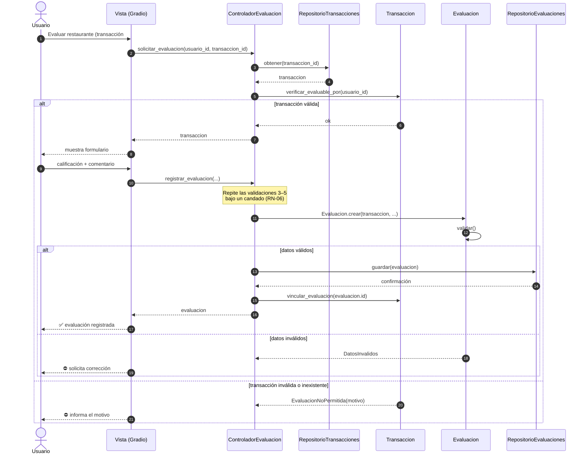
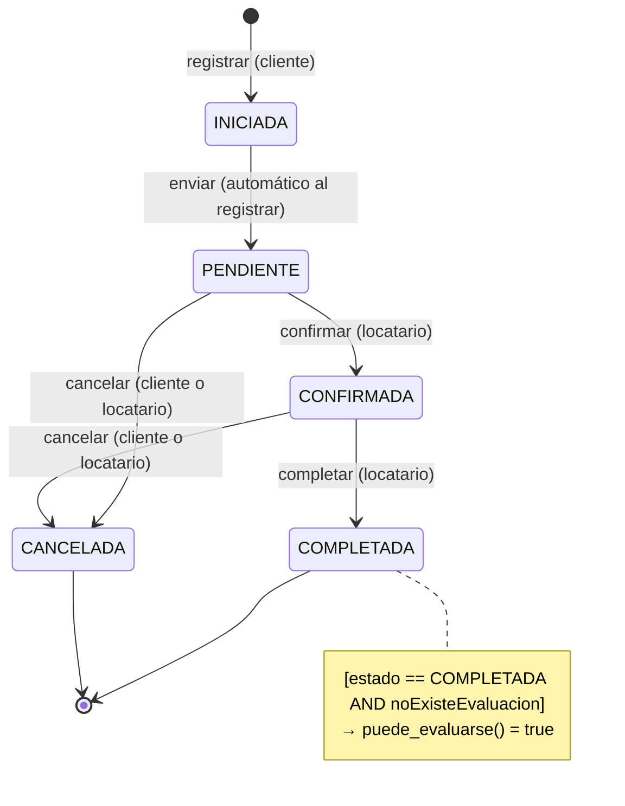
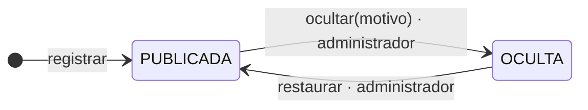

# 07 · Diseño dinámico

> Fuente: Documento Fundamental, sección 10.

## Diagrama de secuencia — CU-01

## Fragmentos alternativos

| Guarda | Comportamiento |
|---|---|
| `[transacción válida]` | Habilitar evaluación → crear y validar → guardar → vincular → confirmar |
| `[transacción inválida o inexistente]` | Rechazar e informar el motivo (`MotivoRechazo`) |
| `[datos válidos]` | Guardar |
| `[datos inválidos]` | Solicitar corrección; la transacción sigue disponible |

## Máquina de estados de Transacción

| Estado | Significado |
|---|---|
| INICIADA | La operación acaba de comenzar |
| PENDIENTE | En espera de confirmación del restaurante |
| CONFIRMADA | El restaurante la confirmó |
| COMPLETADA | La relación comercial concluyó; **puede** respaldar una evaluación |
| CANCELADA | Terminó sin completarse; **nunca** respalda una evaluación |

Las transiciones permitidas están en `TRANSICIONES_TRANSACCION` (`dominio/estados.py`). Cualquier otra —por ejemplo **CANCELADA → COMPLETADA**— lanza `TransicionInvalida`. Cada transición queda en `Transaccion.historial` con fecha, actor y nota.

## Estados de Evaluación (agregado)

Una evaluación **OCULTA** no cuenta para el ranking, pero la transacción **no se libera**: no puede respaldar una nueva evaluación.
